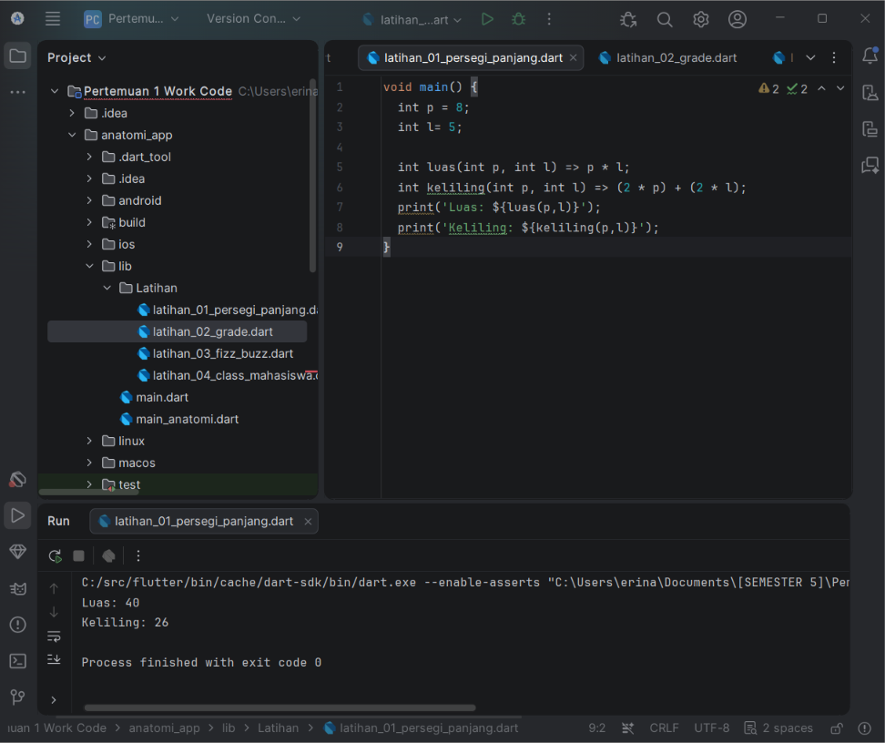
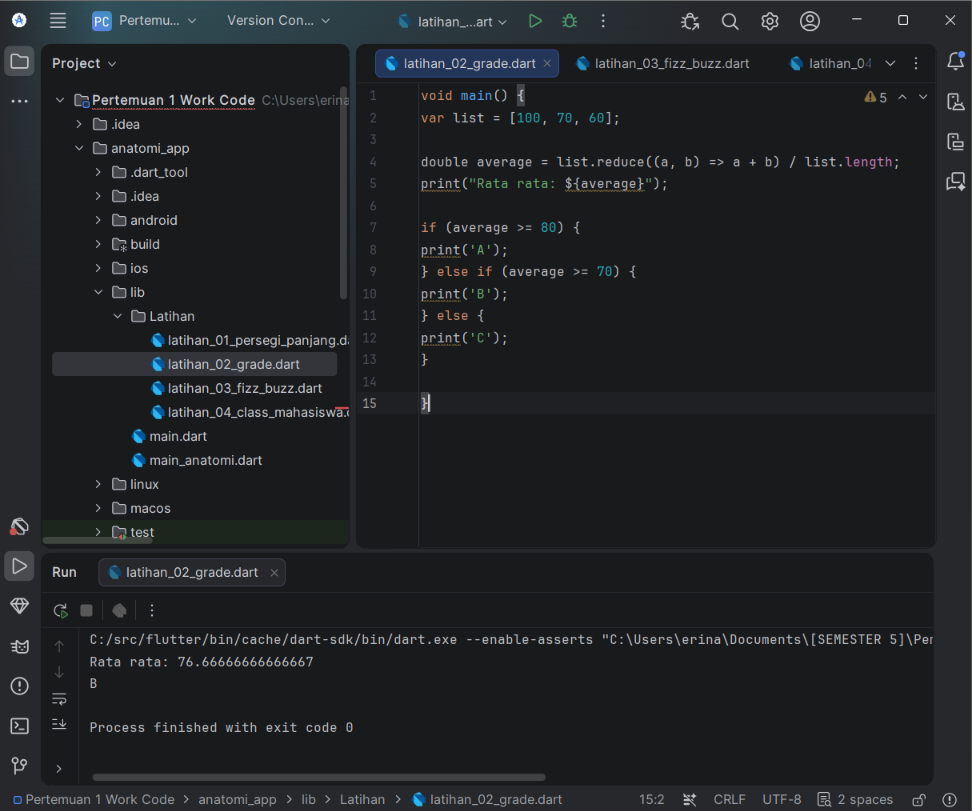
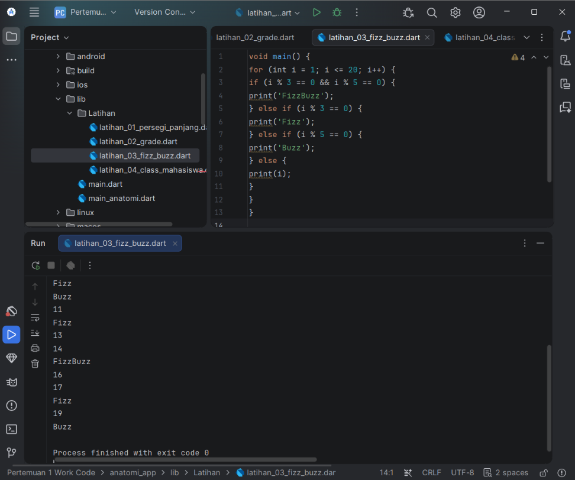
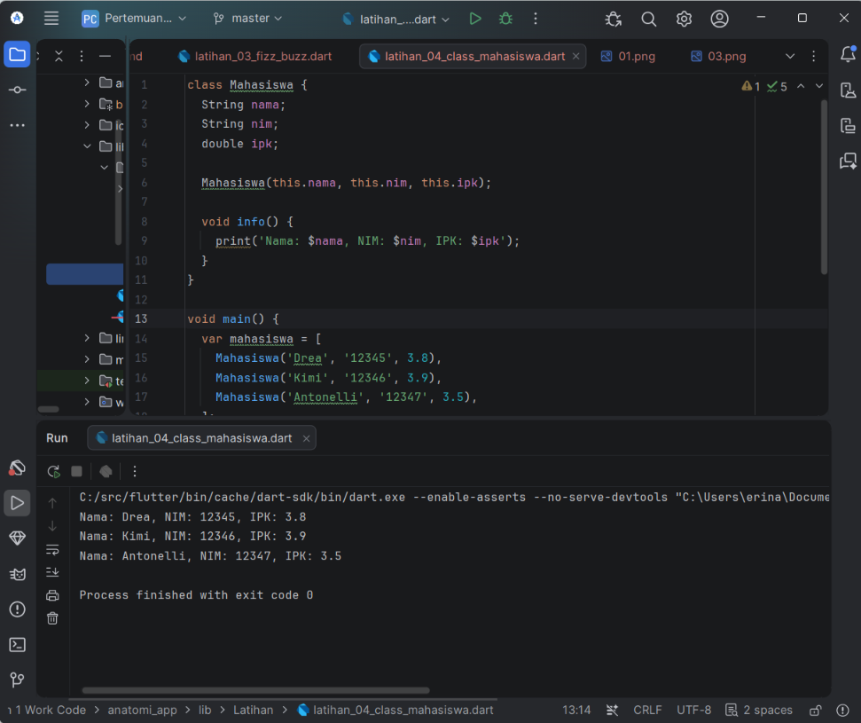

# Latihan Dasar Pemrograman Dart

Tugas **Pemrograman Aplikasi Mobile — Pertemuan 1**

## Hasil Pengerjaan
### 01. Menghitung Luas dan Keliling Persegi Panjang


### 02. Menghitung Rata-rata dan Grade



### 03. FizzBuzz 1–20



### 04. Class Mahasiswa



## Struktur Folder

```text
anatomi_app/
├── lib/
│   └── Latihan/
│       ├── latihan_01_persegi_panjang.dart
│       ├── latihan_02_grade.dart
│       ├── latihan_03_fizz_buzz.dart
│       ├── latihan_04_class_mahasiswa.dart
│       └── proof_of_work/
│           ├── 01.png
│           ├── 02.png
│           ├── 03.png
│           └── 04.png
└── README.md
```